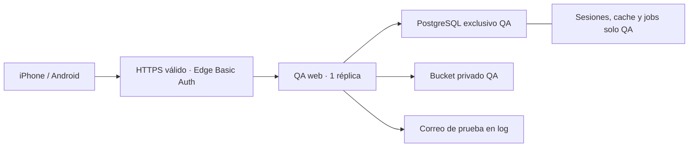

# AREVANTES PWA — Plan ejecutable de staging privado

Auditoría de solo lectura, 23/10/2026. Sin creación de recursos, despliegue, migraciones, usuarios, commit, push, merge ni PR. Los nombres QA de este documento son propuestas, no recursos existentes.

## Decisión de arquitectura

Reutilizar la organización y el alojamiento Laravel Cloud existentes, con una **aplicación independiente Arevantes-PWA-QA**, un entorno **validation** y un corte Git específico de QA. No clonar un preview ni conectar recursos de production. Mantener la misma región europea si el PostgreSQL elegido está disponible en ella; confirmar la combinación de región/producto antes de crear.

Protección propuesta: **HTTP Basic Authentication nativa en el edge de Cloud**, documentada para planes Growth o superiores, además del login y permisos de Laravel. No se presupone allowlist de IP. El acceso por IP que documenta el CLI para salidas no equivale a un firewall de entrada.

Esta decisión queda condicionada a comprobar la habilitación del plan y a que la protección cubra también los hostnames técnicos y los recursos de instalación en Safari/Chrome. No se publica una versión temporal sin protección mientras se resuelven esos puntos.

### Alternativas auditadas

| Opción | Disponible / valoración |
| --- | --- |
| Nuevo entorno en Arevantes | Cloud admite entornos con recursos y ajustes propios; es viable si se revisan todas sus asociaciones, pero conserva proximidad operativa al contexto productivo. No seleccionado. |
| Reutilizar preview antiguo | Hay dos, pero no se certificó origen de datos/configuración; no seleccionado aunque estén en reposo. |
| Nueva aplicación dentro de la organización | Seleccionada: reutiliza cuenta, proveedor Git y región, con contexto/recursos/variables nuevos y menor riesgo de despliegue cruzado. |
| Allowlist de entrada / red privada | No confirmada en la cuenta; no se utiliza como requisito supuesto ni se adquiere un add-on. Se elige la Basic Auth documentada, sujeta al plan. |

“Privado” significa HTTPS públicamente resoluble con acceso autenticado en edge y ERP; no una VPC inaccesible desde Internet. Si se exige aislamiento de red estricto, esta arquitectura necesita revisión y presupuesto diferente.

## Lo confirmado en la cuenta

- Organización configurada: `org-a277fe9c-01e8-4862-838b-884f249f0d62` (Joaquin).
- Aplicación productiva Arevantes: `app-a278002b-6929-4213-a40e-4ab5c197e220`, región `eu-central-1`.
- Entorno production: `env-a278002d-4d7c-4fc2-8920-1034fe592f20`, rama main, PHP 8.5, Node 24, un servidor flex-512mb. Scheduler deshabilitado y sin workers en el inventario consultado.
- Hay dos previews antiguos: codex-fix-permission y codex-fix-purchase-c. Que ya existan no demuestra aislamiento: **no se reutilizan**.
- Los listados de bases y cachés administradas de la organización están vacíos. Production tiene variables explícitas de conexión a una base externa: no se puede deducir su seguridad ni compartirla para QA.
- Hay cuatro buckets privados R2, incluidos recursos productivos y de previews. **Ninguno se reutiliza**.
- `.cloud/config.json` local selecciona production. Debe quedar intacto; cualquier trabajo futuro usará un contexto QA separado y destino explícito.

El inventario es una fotografía, no una reserva de precios/capacidad. No se han leído valores de secretos ni ejecutado comandos dentro de production.

## Costes estimados y presupuesto propuesto

Tarifas consultadas el 23/10/2026 en [precios oficiales de Cloud](https://laravel.com/cloud/pricing), Frankfurt/eu-central-1. USD, sin impuestos. Son estimaciones de uso, no una factura ni un precio cerrado.

| Concepto | Tarifa utilizada |
| --- | --- |
| Flex 512 MB | 0,010416672 USD/h activa; tope de cómputo web 7 USD/mes. |
| PostgreSQL mínimo 0,25 CU | 0,106 USD/CU-h; equivale a 0,0265 USD/h activa, sin aplicar el tope del servidor web. |
| Almacenamiento PostgreSQL | 0,50 USD/GB-mes; PITR/logs se cotizan aparte antes de crear. |
| Bucket privado | 0,02 USD/GB-mes; operaciones A 0,005 USD/1000 y B 0,0005 USD/1000. |
| Tráfico de aplicación | 0,10 USD/GB una vez superada la franquicia organizativa; no presumir saldo libre. |
| Plan Growth | 20 USD/mes por organización; Starter 5 USD. Incremento 15 USD si actualmente es Starter; cero cuota adicional si ya es Growth o superior. |

**Escenario de ronda:** 60 horas facturables de web y 60 de PostgreSQL, 1 GB de base y 1 GB de archivos: 0,625 + 1,59 + 0,50 + 0,02 = **2,735 USD (~2,74)** de recursos. Dormir el servidor no garantiza que PostgreSQL duerma simultáneamente; medir ambos. Las comprobaciones periódicas también pueden mantener recursos despiertos.

**Escenario sin reposo:** 730 horas PostgreSQL y cómputo web con su tope: 7 + 19,345 + 0,50 + 0,02 = **26,865 USD (~26,87)** al mes. Operaciones, tráfico excedente, PITR, impuestos y eventual cuota de plan van aparte. No descontar créditos compartidos de la organización ni asumir que los previews son gratuitos.

Proponer una ventana de QA de 7 días, recursos con reposo y un presupuesto de revisión de **10 USD de recursos**, con revisión diaria y parada manual si el consumo proyectado lo supera. No es un límite técnico garantizado. Si se desea mantener QA un mes entero, volver a estimar. Todo cambio de plan se aprobará aparte tras confirmar Billing y prorrateo. No cambiar límites organizativos que puedan suspender production; no hay una cuota aislada QA confirmada.

**Pendiente real:** la API/usage consultada no devuelve el plan contratado. Se intentó abrir Billing en el navegador de Codex, pero el panel solicita iniciar sesión; no había sesión autenticada disponible ni se introdujeron credenciales. Confirmar en Billing el plan y la habilitación Basic Auth antes de crear recursos; también región, mínimo/máximo CU y coste/retención PITR en el formulario de configuración. Si no puede fijarse 0,25 CU máximo o cambia la tarifa, recalcular y pedir aprobación; no presentar 2,74 USD como techo.

## Topología mínima



| Recurso | Propuesta | Aislamiento |
| --- | --- | --- |
| Aplicación / entorno | Arevantes-PWA-QA / validation, sin despliegue automático | No heredar el contexto, variables, deploy hooks o recursos de Arevantes production. |
| Web | Una réplica Flex 512 MB para la ronda; subir solo si medición lo exige | Sin workers adicionales ni scheduler. Reposo/hibernación si está disponible, asumiendo arranque en frío al reabrir. |
| PostgreSQL | Cluster nuevo Serverless PostgreSQL 0,25 CU mínimo/máximo si lo admite la configuración, reposo habilitado y base QA propia | Usuario/contraseña y endpoint nuevos; no esquema dentro de la base productiva. |
| Sesiones | SESSION_DRIVER=database | Tabla sessions de la base QA; cookie y APP_KEY propias. |
| Caché | CACHE_STORE=database | Tablas cache/cache_locks de QA y CACHE_PREFIX exclusivo. No Redis/Valkey adicional. |
| Cola | QUEUE_CONNECTION=database, DB_QUEUE=qa-validation | Jobs de QA sin worker general durante la ronda; no elegir sync porque ejecutaría trabajos externos inmediatamente. |
| Archivos | Bucket privado QA nuevo; disco privado s3 | Credenciales con acceso solo a ese bucket, nunca claves organizativas amplias. |
| Correos / tiempo real | MAIL_MAILER=log, BROADCAST_CONNECTION=log | Sin SMTP productivo, Reverb ni APNs. |
| Integraciones | Sin credenciales; scheduler y automatizaciones deshabilitados | No fabricantes, IA, inbox, banca, pagos, webhooks o backups productivos. |

CACHE/SESSION/QUEUE connection overrides no deben apuntar a otra conexión: dejarlos vacíos para heredar exclusivamente la conexión QA o asignar explícitamente la misma conexión verificada. La clave de cifrado no se copia de producción y no se importa ninguna copia de seguridad real.

## Contrato de configuración

Permitir solo variables generadas para QA y una lista explícita de valores inocuos. No exportar/copiar el .env productivo, los secretos organizativos ni un clon de variables de preview.

```dotenv
APP_NAME="AREVANTES QA"
APP_ENV=production
APP_DEBUG=false
APP_URL=https://HOST-QA-CONFIRMADO
SESSION_DRIVER=database
SESSION_COOKIE=arevantes_qa_validation_session
SESSION_DOMAIN=null
SESSION_SECURE_COOKIE=true
SESSION_HTTP_ONLY=true
SESSION_SAME_SITE=lax
CACHE_STORE=database
CACHE_PREFIX=arevantes_qa_validation_
QUEUE_CONNECTION=database
DB_QUEUE=qa-validation
MAIL_MAILER=log
BROADCAST_CONNECTION=log
PRIVATE_FILESYSTEM_DISK=s3
FILESYSTEM_DISK=s3
INERTIA_SSR_ENABLED=false
POSTGRES_BACKUP_ENABLED=false
POSTGRES_RESTORE_VERIFICATION_ENABLED=false
```

El hostname es un marcador, no una URL publicada. APP_ENV=production aquí activa las cabeceras de seguridad del código existente; **no implica conectar a producción**. Las etiquetas Cloud y credenciales siguen siendo QA. DB_*, APP_KEY y AWS_* solo se completarán con valores de los recursos nuevos; no se escriben en el documento o Git.

La clave S3 autoriza únicamente el bucket QA. Dejar vacíos también AWS_URL y cualquier override de endpoint productivo antes de conectar el bucket nuevo. POSTGRES_BACKUP_*, claves de proveedores, SMTP, AI, APNs, Slack y bandejas entrantes no se adjuntan. Revisar las claves efectivas generadas por la plataforma y sus asociaciones sin exponer sus valores.

No existe hoy un entorno QA cuya configuración se pueda certificar: la comprobación negativa efectiva de conexiones, secretos y permisos se realizará **antes de su primera publicación**, siguiendo esta lista de exclusión. La auditoría actual confirma que no se ha creado ni conectado nada.

## Corte Git reproducible

Estado revisado: rama local `feature/technician-skill-checklist`, HEAD `457ae23ba80c9826cbb748f662edf19a402421d5`. `git ls-remote` confirmó main remoto `f79866655e90b34c491c261158d8c747808ac9b6` y develop `98a875051505fae0e3e0ea142f29b89f1fb5e7f4`. No se hizo fetch ni se actualizaron ramas locales.

Se creó `docs/pwa-qa-source-inventory.json`: 40 archivos pendientes previos a esta entrega, incluidos archivos sin seguimiento, tamaño y SHA-256. No contiene secretos ni archivos ignorados. Los documentos de este plan y el propio inventario se añadieron después de esa fotografía.

Hallazgo relevante: app-sidebar-header.tsx, nav-main.tsx, ui/sidebar.tsx y tests/mobile-navigation.test.mjs **ya coinciden byte a byte con main**. No trasladar el hotfix anterior otra vez. En app.css, la diferencia respecto de main se reduce a la importación de mobile-app.css. El diff normal no incluye archivos nuevos: usarlo solo borraría del corte los diez archivos nuevos de ejecución PWA y sus pruebas. Incluso presenta como borrados algunos archivos existentes en main cuyo equivalente local está sin seguimiento; no aceptar esas eliminaciones automáticamente.

### Procedimiento futuro, sin ejecutarlo ahora

1. Revalidar status y hashes; si cambió cualquier archivo, detener y reconciliar la variación. No reset, clean, stash ni cambio de rama en la copia servida.
2. Autorizar por separado un corte Git QA. Crear un checkout aislado desde el SHA exacto de main verificado, sin tocar main/develop. Nombre sugerido de rama: qa/pwa-mobile-validation.
3. Trasladar solo los cambios PWA respecto de esa base, incluyendo E-01/E-02 y archivos nuevos listados en el inventario. Mantener los archivos del hotfix que ya trae main.
4. Tratar roadmap y documentación por bloques: conservar la versión de main e incorporar los bloques PWA/estabilización/QA; no reemplazar el roadmap completo. Revisar el informe antiguo del menú por contenido, no aceptar una falsa eliminación derivada del índice local.
5. Excluir .cloud/config.json productivo, .env, public/hot, build generado, bases, storage, certificados, credenciales y archivos de tareas ajenas. Las capturas y documentos pueden incluirse si se aprueban expresamente; no son dependencias del runtime.
6. Revisar el diff completo y comparar lista de archivos con la allowlist, buscar secretos y ejecutar pruebas frontend/backend, tipos, lint, i18n y build en ese checkout. Los 20 faltantes i18n previos se resolverán o se documentará una decisión explícita del corte; no ocultarlos.
7. Solo con autorización adicional, commit y push de la rama QA, sin PR/merge/main/develop. Registrar SHA y hashes. Cloud no puede desplegar los cambios locales sin un corte accesible al proveedor Git: desplegar el HEAD actual no basta.
8. Configurar Cloud con ese SHA/rama y despliegue manual; comprobar antes y después el SHA efectivo. La selección de rama tampoco autoriza push-to-deploy.

No se crea checkout, rama, commit o archivo de parche aplicable automáticamente en esta fase. El inventario permite revisar exactamente qué se propone trasladar.

## Bootstrap diseñado, no ejecutado

No usar DatabaseSeeder sin revisión: crea Test User con fábrica y llama a sincronización de ubicaciones. No reutilizar cuentas locales, datos ni los demo seeders completos.

Proponer un bootstrap QA explícito, con guardas antes de escribir: aplicación y entorno esperados; hostname QA; base/host QA; bucket QA; marcador de dataset y ausencia de usuarios no sintéticos. Si falta una guarda, abortar. Ejecutarlo solo sobre la base recién creada tras migraciones revisadas, nunca sobre bases existentes.

| Cuenta sintética | role / perfil real | Prueba |
| --- | --- | --- |
| qa.admin@example.test | admin / administrator | Configuración y recorrido autorizado completo. |
| qa.commercial.a@example.test y qa.commercial.b@example.test | commercial / commercial | Tareas, clientes y aislamiento entre responsables. |
| qa.technician.a@example.test y qa.technician.b@example.test | technician / technician | Operaciones propias; rechazo de acceso a datos ajenos. |
| qa.finance@example.test | commercial / finance, asignado expresamente | Navegación restringida por perfil existente, sin asumir un rol manager/viewer inexistente. |
| qa.restricted@example.test | technician / perfil QA explícito sin permisos | Ocultación de destinos y rechazo de accesos directos; validar también los gates que dependan de role. |

Los perfiles reales iniciales incluyen administrator, commercial, finance, purchasing, human-resources y technician. Comprobar sus permisos efectivos tras todas las migraciones. **No dejar permission_profile_id nulo:** PermissionResolver tiene fallback legacy que podría conceder más acceso. El perfil QA vacío utiliza las tablas y servicios existentes; no requiere una migración nueva.

Credenciales aleatorias por cuenta, sin claves de fábrica, almacenadas en un gestor seguro y entregadas fuera de Git/documentos. Caducidad operativa: desactivar/revocar cuentas al terminar, sin eliminar recursos hasta autorización. Registro público de usuarios debe estar deshabilitado o restringido antes de aceptar la puerta QA; no crear personas reales para acceder.

Dataset determinista: nombres QA sin identidades reales, correos example.test, direcciones ficticias; dos clientes, una oportunidad, un proyecto/instalación, tareas de ambos técnicos, una vencida y otra sin fecha, una factura sintética si el recorrido la necesita y un PDF ficticio marcado QA. Referencias y relaciones se crean con los servicios/fábricas actuales; no inventar un segundo modelo. Registrar IDs generados en un manifiesto de ejecución para repetir sin duplicar. Ninguna factura se envía, contabiliza en sistemas externos ni firma con credenciales reales.

## Requisitos de publicación comprobados en el código

- PHP ^8.4.1 / Laravel ^13.7; usar 8.5 con parche vigente y pdo_pgsql. Local satisface el lock en PHP 8.5.12; no se cambia el runtime productivo.
- La cuenta productiva usa Node 24; Vite admite >=22.12. Propuesta QA: Node 24 para reducir divergencia, con npm ci y lockfile del corte.
- Build propuesto: `composer install --no-dev --no-interaction --prefer-dist --optimize-autoloader`, `npm ci`, `npm run build`, optimización Laravel tras validar variables QA. Root public y sin public/hot.
- Deploy propuesto: comprobar destino vacío de QA; solo entonces migraciones en su nueva base. No ejecutar composer setup, migrate:fresh ni restore.
- Sesiones, cache y jobs tienen soporte database en config; no hace falta Redis para esta ronda.
- config/filesystems.php permite S3 privado con AWS_*; deben ser credenciales QA nuevas y acotadas. No usar disco local efímero para certificar documentos entre despliegues.
- routes/console.php contiene sincronizaciones externas y procesos financieros: scheduler y workers permanecen deshabilitados. Las colas de producción no se montan.

## Checklist de aceptación

Registrar versión exacta, dispositivo, SO, navegador, modo normal/instalado y resultado por caso.

- [ ] Edge Basic Auth rechaza una sesión anónima, incluidos dominio técnico y alternativo; login Laravel sigue siendo obligatorio.
- [ ] Certificado válido y redirección HTTPS; cookies host-only, Secure/HttpOnly y clave exclusiva.
- [ ] Manifest/iconos/worker responden correctamente desde la red y credenciales autorizadas; no HTML/401 inesperado al instalar.
- [ ] Nueva instalación y actualización desde una instalación anterior de PWA, sin duplicados de identidad.
- [ ] Barra inferior, Menú, submódulos, permisos y navegación a fichas; retroceso con filtros/scroll/foco coherentes.
- [ ] E-01: hoja limpia, modificada, cancelar/descarte por botón/Escape/retroceso/exterior; tres campos conservados, foco seguro y limpieza al guardar.
- [ ] Validación, 419, 500, red lenta, desconexión y doble toque; una sola alta válida, sin reenvío silencioso.
- [ ] Teclado y selector de fecha, safe areas, orientación y zoom; botón final accesible.
- [ ] Logout + Atrás, cerrar/reabrir instalada, cambio de usuario/empresa y caducidad; ningún dato de otro usuario.
- [ ] Build A/B con formulario abierto, dos pestañas y modo instalado: no recarga automática ni pérdida de borradores.
- [ ] CacheStorage solo público; no cache compartida de HTML/Inertia/documentos privados; offline no crea operaciones ni expone datos guardados.
- [ ] Escritorio a 1440 px y frontera 1023/1024; no barra móvil duplicada ni pérdida silenciosa al rotar/multiventana.
- [ ] Correo en log, sin llamadas reales a fabricantes/IA/inbox/banca/pagos; verificar destinos efectivos antes de cada recorrido con integración.

El Basic Auth de edge añade un reto HTTP anterior al login. Safari normal y la app instalada pueden requerir autenticación separada: si el modo instalado no logra recuperar manifest/worker bajo esa protección, la prueba no se considera aprobada. No se solventará haciendo público el origen sin una nueva decisión de acceso autorizada.

## Entrega de URL y acceso

Tras aprobación y puesta en marcha verificada se entregará la URL HTTPS efectiva, SHA, dataset/fecha, plazo de disponibilidad y responsables. Nunca una URL con usuario:contraseña o tokens. Las credenciales de edge y ERP se entregarán separadamente por canal privado; no se añadirán al repositorio, QR o captura.

- iPhone: Safari → URL QA → reto de edge → login QA → recorrido normal → Compartir/Añadir a pantalla de inicio → abrir icono → repetir acceso si lo requiere. Probar también regreso desde segundo plano.
- Android: Chrome → URL QA → edge + login → recorrido normal → menú Instalar aplicación/Añadir a inicio → abrir icono → repetir. Distinguir instalación standalone de acceso directo.
- El Mac y localhost:8000 no participan en el acceso remoto; no se abre su puerto a Internet ni se crea un túnel al entorno con datos locales.

## Secuencia concreta y puntos de parada

1. Aprobar arquitectura, presupuesto y acceso edge. Confirmar plan Growth+ y habilitación Basic Auth; no pagar un cambio de plan sin aprobación.
2. Autorizar preparación/versionado Git y bootstrap QA en una segunda fase. Esta entrega no autoriza esas escrituras.
3. Preparar checkout y corte revisado; pasar controles. Push de rama QA solo con autorización expresa.
4. Crear aplicación/entorno QA, PostgreSQL y bucket nuevos con el presupuesto aprobado; anotar IDs y comprobar que ninguno coincide con producción/previews.
5. Configurar variables por allowlist, secretos propios, TLS, edge Basic Auth, sin P2D/hooks/colas/scheduler. Revisar el plan de despliegue antes de ejecutar.
6. Primera publicación manual con acceso edge ya incluido en la configuración, sin datos de usuarios; comprobar protección del origen. Solo entonces migraciones en la base nueva y bootstrap sintético aprobado. Si Cloud requiere desplegar para aplicar Basic Auth, no hacer una publicación abierta intermedia.
7. Confirmar SHA/recursos/cabeceras; entregar URL y credenciales separadas. Ejecutar matriz real y registrar incidencias.
8. Aprobar de forma independiente build B, correcciones o promoción; no promover este QA a producción por terminar pruebas.
9. Apagar/retirar QA al acabar según autorización; registrar coste y revocar credenciales. No eliminar automáticamente recursos con datos sin aprobación.


## Fuentes, alcance y estado final

Auditoría Cloud por CLI autenticado en modo lectura: listados de aplicaciones, entornos, instancias, recursos, usage y metadatos de variables; valores sensibles enmascarados y sin --show-sensitive. Los campos de API no permiten demostrar la inexistencia de herencia de variables a nivel organización/aplicación; por eso se exige una aplicación nueva y revisión de configuración efectiva antes de publicar. Las listas vacías de secrets adjuntos no prueban ausencia de secretos en variables.

Fuentes primarias: [entornos y HTTP Basic Auth](https://laravel.com/cloud/docs/environments#http-basic-authentication), [precios regionales](https://laravel.com/cloud/pricing), [PostgreSQL](https://laravel.com/cloud/docs/resources/databases/postgres), [almacenamiento](https://laravel.com/cloud/docs/resources/object-storage), [red y direcciones de salida](https://laravel.com/cloud/docs/network). La protección se configura en General Settings → Security y requiere deploy para aplicarse; el CLI instalado no expone esa opción en environment:update, por lo que se prevé un paso de dashboard. Usar una contraseña nueva exclusiva de edge (restricciones documentadas: 5–32 caracteres, sin dos puntos), distinta de las cuentas ERP.

Se añaden únicamente este plan, el inventario SHA-256 y una nota de roadmap. Los 40 archivos previos se conservan. No se repiten pruebas de aplicación en esta fase documental: la última verificación local de E-01 fue 29 pruebas frontend, 40 backend, tipos, lint y build correctos; el candidato reproducible debe volver a verificarse una vez preparado.

**Punto de parada:** arquitectura y secuencia preparadas; aprobación pendiente de presupuesto/plan, preparación Git, recursos y publicación. No se interpreta la aprobación del plan como permiso implícito para commit, push o desplegar.

**Commit: NO. Push: NO. Merge: NO. Pull Request: NO. Despliegue: NO. Recursos de pago creados: NO.**
